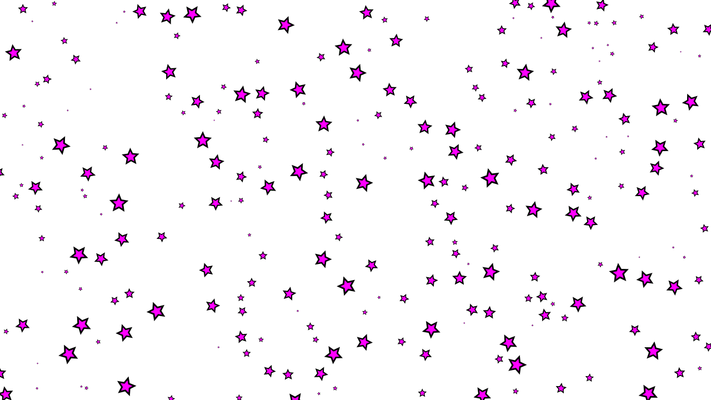

# Inkscape Noise Tiling

Scatter randomized copies of selected objects over a region, with placement probability driven by configurable 2D noise (Simplex, fBm, or Turbulence). Higher noise values → higher spawn chance. Overlaps are avoided via AABB collision detection; each copy gets random rotation and scale.

## Features

- Configurable noise type: **Simplex**, **fBm** (fractal Brownian motion), or **Turbulence**
- Adjustable fractal parameters (octaves, lacunarity, gain) for fBm and Turbulence
- No-overlap placement (AABB + padding)
- Random rotation & scale (configurable ranges)
- Tiling area anchored to the selected object's top-left corner
- Reproducible layouts via a fixed noise seed

## Install

Copy both files into your Inkscape extensions folder:

- **Linux:** `~/.config/inkscape/extensions/`
- **Windows:** `%APPDATA%\inkscape\extensions\`
- **macOS:** `~/Library/Application Support/org.inkscape.Inkscape/config/inkscape/extensions/`

Restart Inkscape.

Requires Inkscape 1.x (Python 3 + `inkex`).

## Usage

1. Select one or more objects to use as templates.
2. Go to **Extensions → Generate from Path → Simplex Noise Tiling**.
3. Adjust parameters and click **Apply**.

## Parameters

| Param | Description |
|---|---|
| Tile Area Width/Height | Size of the tiling region (starts at template's top-left corner) |
| Noise Scale | Smaller = smoother/larger clusters |
| Noise Type | Noise algorithm: `simplex` (single-octave), `fbm` (fractal sum), or `turbulence` (absolute-value fractal sum) |
| Octaves | Number of noise layers summed (fBm / Turbulence only) |
| Lacunarity | Frequency multiplier between octaves (fBm / Turbulence only) |
| Gain | Amplitude multiplier between octaves (fBm / Turbulence only) |
| Probability Threshold | Filter out low-noise positions (0–1) |
| Noise Seed | `0` = random each run; any positive value reproduces the same layout |
| Max Placement Attempts | Upper bound on placement tries |
| Min/Max Random Scale | Scale range for each copy |
| Min/Max Random Rotation (deg) | Rotation range for each copy |
| Padding | Extra gap enforced between objects |

### Noise types

- **Simplex** — plain single-octave 2D simplex noise. Smooth, large-scale gradients.
- **fBm** — sums multiple octaves of simplex noise with decreasing amplitude (`gain`) and increasing frequency (`lacunarity`). Produces natural, cloud-like variation.
- **Turbulence** — like fBm but uses the absolute value of each octave, creating sharper, more "veiny" or fiery patterns.

## License

MIT